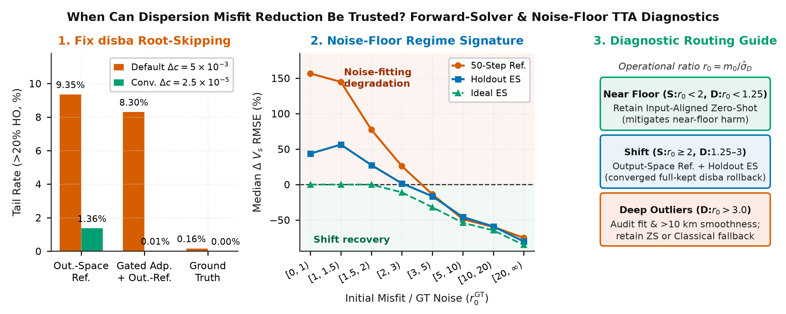

<div align="center">

<h1>SWI-TTA</h1>

<h3>Noise-Floor Regimes and Forward-Solver Pitfalls in Test-Time Adaptation<br>for Deep Surface-Wave Dispersion Inversion</h3>

<p><em>Computers &amp; Geosciences</em> (Submitted Manuscript &amp; Open-Source Diagnostic Suite)</p>

<p>
  <a href="https://luoyoooo.github.io/SWI-TTA/"><strong>🌐 Project Page</strong></a> &nbsp;|&nbsp;
  <a href="docs/USER_GUIDE.md"><strong>📘 User Guide</strong></a> &nbsp;|&nbsp;
  <a href="tutorials/"><strong>🚀 Tutorials</strong></a> &nbsp;|&nbsp;
  <a href="docs/PROTOCOL.md"><strong>🧭 4-Step Protocol</strong></a> &nbsp;|&nbsp;
  <a href="docs/FIGURE_TABLE_MAP.md"><strong>📊 Figures &amp; Tables</strong></a> &nbsp;|&nbsp;
  <a href="data/DATA_AVAILABILITY.md"><strong>🤗 OpenSWI Data</strong></a>
</p>

<p>
  <a href="LICENSE"></a>
  <a href="pyproject.toml"></a>
  <a href="https://github.com/Luoyoooo/SWI-TTA/actions/workflows/ci.yml"></a>
  <a href="docs/FIGURE_TABLE_MAP.md"></a>
</p>

<br>



<p><em><strong>Core diagnostic question:</strong> Without shear-wave velocity (V<sub>s</sub>) ground truth on field arrays, how far can dispersion misfit reduction be trusted?</em></p>

</div>

---

## Overview & Key Findings

Pretrained neural surface-wave inversion models (such as **OpenSWI-Transformer** and **DispFormer**) invert dispersion curves orders of magnitude faster than classical global optimization, yet their predictions degrade under period-grid, sedimentary-prior, or lithospheric shifts. Across **10 TTA pipelines**, **2 Transformer backbones**, **6 synthetic domains**, and **2 field arrays** (LongBeach and CSRM), **SWI-TTA** establishes three governing diagnostic mechanisms:

- **Converged Forward-Solver Auditing Eliminates Artificial LVZ Tails**: Coarse phase-velocity stepping (`dc = 5.0e-3 km/s`) in `disba` skips Mode 0 onto Mode 1 on shallow profiles containing deep low-velocity zones (LVZs). Refining to **`dc = 2.5e-5 km/s`** (shallow) while keeping **`dc = 5.0e-3 km/s`** (deep) collapses artificial `>20%` held-out misfit tails (`Output-Space Refinement`: **9.35% → 1.36%**; `Gated Adapter + Output-Refined`: **8.30% → 0.01%**; representative `#9391`: **63.84% → 0.65%**, verified to `0.000087%` against an independent 6×6 Dunkin compound-matrix solver).
- **Semi-Convergence Near the Observational Noise Floor**: Even under converged forward scoring, refining near or below the noise floor lowers held-out dispersion misfit while degrading $V_s$ accuracy (`+21.86%` RMSE degradation on Deep Benchmark; `+156.67%` median degradation in `[0, 1)` on Shallow Multi-Structure; controlled noise scan flips from `-9.56%` at `0.5×` to `+46.93%` at `4.0×`). Under strong prior shift, adaptation reduces $V_s$ RMSE by up to **`-57.79%`**.
- **Regime-Aware Four-Step Operational Protocol**: Single-threshold Morozov discrepancy stopping fails simultaneous multi-domain validation (`0/4` passing across $\alpha \in \{1.0, 1.25, 1.5, 2.0\}$). Combining validation-locked operational $r_0 = m_0 / \hat{\sigma}_D$ screening (`r_0 >= 2.0` shallow; `1.25 <= r_0 <= 3.0` deep) with unfrozen internal 80/20 **Holdout ES** and exact converged `disba` rollback improves all **63 checkpoints across 14 cohorts** while saving up to **`77.2%`** of exact forward-solver calls (**`67.5%`** on CSRM Report).

---

## 30-Second Quick Start (Pure CPU)

No GPU or multi-gigabyte dataset download is required to verify the physics audit, run unit tests, and reproduce every manuscript figure and table.

```bash
git clone https://github.com/Luoyoooo/SWI-TTA.git
cd SWI-TTA
python -m venv .venv && source .venv/bin/activate
pip install -r requirements.txt && pip install -e ".[dev]"

# 1. Pure-CPU installation check + live shallow LVZ root-skipping demo (< 1 s)
python scripts/verify_install.py

# 2. Full unit, invariant, zero-leakage, and hygiene test suite (~5 s)
pytest -v

# 3. Inspect closed-loop 14-cohort operational protocol summary (< 1 s)
python scripts/run_operational_protocol.py --summary-check

# 4. Reproduce all 15 figures (PDF/PNG/SVG) and 7 tables (MD/LaTeX) on CPU (~22 s)
python scripts/reproduce_tables.py
python scripts/reproduce_all_figures.py
```

---

## Minimal Python API

```python
from swi_tta.physics.disba_referee import (
    DEFAULT_SHALLOW_DC_KM_S,
    forward_dispersion_diag,
)
from swi_tta.adaptation.safe_tta import run_operational_protocol

# 1. Verify converged fundamental-mode Rayleigh dispersion on a shallow profile
diag = forward_dispersion_diag(vs_profile, depth_km, periods_s, mode=0, dc=DEFAULT_SHALLOW_DC_KM_S)

# 2. Execute the four-step operational protocol (r_0 routing + unfrozen Holdout ES + rollback)
vs_adapted, info = run_operational_protocol(
    vs_init_aligned, surrogate_ensemble, depth_km,
    periods, phase_vel, group_vel, obs_mask, kept_mask,
    domain="shallow", sigma_hat_d=0.00932, dc_shallow=DEFAULT_SHALLOW_DC_KM_S, disba_workers=4,
)
print(f"Routed: {info['routed_fraction']*100:.1f}% | disba saved: {info['disba_call_savings_vs_unrouted_hes_pct']:+.1f}%")
```

See [`docs/USER_GUIDE.md`](docs/USER_GUIDE.md) for complete input/output schemas, CLI flags, and Python API details, and [`tutorials/`](tutorials/) for 3 runnable pure-CPU Jupyter notebooks.

---

## Key Quantitative Benchmarks

| Benchmark / Audit | Key Diagnostic Metric | Verified Result |
| :--- | :--- | :--- |
| **Shallow LVZ Audit (`disba` Step)** | `>20%` HO tail: `dc=5e-3` → `dc=2.5e-5` (`#9391`) | Out.-Space Ref.: **9.35% → 1.36%**; Gated Adp.+Out.: **8.30% → 0.01%** (**63.84% → 0.65%**) |
| **LongBeach-Matched (Test)** | Resolvable-Depth $V_s$ RMSE (`Aligned ZS` → `Gated Adp.+Out.` / `Protocol`) | **0.1179 → 0.0498 km/s (-57.79%)** / **0.0588 km/s (-50.18%)** |
| **Shallow Benchmark (Test)** | `50-Step` vs `4-Step Protocol` (All / Retrained-only) | **-6.74% / +5.87%** → **-25.81% / -13.88%** (`+50.0%` `disba` saved) |
| **Deep Benchmark (Test)** | `50-Step` vs `4-Step Protocol` (All / Retrained-only) | **+21.86% / +24.05%** → **-3.30% / -3.83%** (`+76.9%` `disba` saved) |
| **Cross-Backbone Diagnostics** | OpenSWI / DispFormer `4-Step Protocol` (Sh. Multi, Sh. Prior, Deep Lith.) | OpenSWI: **-22.86% / -40.48% / -3.63%**; DispFormer: **-15.49% / -17.48% / -5.45%** |
| **Noise Amplitude Scan (`0.5×–4.0×`)** | $\hat{\sigma}_D / \sigma_{\text{GT}}$ tracking; `50-Step` vs `Holdout ES` | **0.929–0.953×**; `50-Step` **-9.56% → +46.93%**; `Holdout ES` **-15.04% → +12.51%** |
| **LongBeach Report (3,705 sta.)** | `4-Step Protocol` HO median ($r_{\text{ref}}$ vs Fu et al., 2022) | **3.75% → 0.82%** (`0.00%` tail; $r_{\text{ref}}$ **0.551 → 0.713**; `98.1%` routed) |
| **CSRM Report (8,842 grid pts)** | `4-Step Protocol` HO median ($r_{\text{ref}}$ vs Xiao et al., 2024) | **1.23% → 1.10%** ($r_{\text{ref}}$ **0.686 → 0.707**; `70.9%` zero-shot; **`+67.5%`** `disba` saved) |

---

## Documentation & Tutorials

- **User Guide** ([`docs/USER_GUIDE.md`](docs/USER_GUIDE.md)): Complete specification of data formats, units, CLI flags, Python APIs, and expected behaviors.
- **Interactive Tutorials** ([`tutorials/`](tutorials/)): Three pure-CPU notebooks covering LVZ root-skipping auditing, zero-leakage & operational protocol execution, and figure/table reproduction.
- **Operational Decision Protocol** ([`docs/PROTOCOL.md`](docs/PROTOCOL.md)): Step-by-step deployment guidelines and freeze-depth ablation rationale.
- **Figure & Table Provenance** ([`docs/FIGURE_TABLE_MAP.md`](docs/FIGURE_TABLE_MAP.md)): Exact item-to-generator mapping for all 15 figures and 7 tables.
- **Data Availability** ([`data/DATA_AVAILABILITY.md`](data/DATA_AVAILABILITY.md)): Upstream OpenSWI CC BY 4.0 access instructions and SHA-256 verification (`scripts/download_data.py`).

---

## Repository Structure

```text
SWI-TTA/
├── README.md                         # Project overview, Quick Start, and C&G code availability
├── LICENSE                           # MIT License
├── CITATION.cff                      # Machine-readable citation metadata (CFF 1.2.0)
├── pyproject.toml                    # Editable package build (import package: swi_tta)
├── environment.yml                   # Conda environment specification
├── requirements.txt / -lock.txt      # Core & pinned Python dependencies
├── src/swi_tta/                      # Core Python package (physics, data, models, adaptation, eval, viz)
├── scripts/                          # 8 CLI entry points (CPU verification, protocol, figures, tables, data)
├── configs/                          # Portable YAML configs (forward solver, calibration, domains, methods)
├── tutorials/                        # 3 pure-CPU Jupyter notebooks for typical workflows
├── docs/                             # USER_GUIDE.md, PROTOCOL.md, FIGURE_TABLE_MAP.md, CODE_AVAILABILITY_BLOCK.md
├── website/                          # Minimalist static project page (auto-deployed via GitHub Pages)
├── data/                             # Deterministic spatial/period split manifests & upstream SHA-256 checksums
├── results_summary/                  # SHA-256-verified compact summary & per-station protocol audit archive
├── figures/                          # Pre-rendered Graphical Abstract, Figs 1-9, Figs S1-S5 (PDF/PNG/SVG)
├── tables/                           # Generated Tables 1-4 and S1-S3 (Markdown & booktabs LaTeX)
└── tests/                            # 22 unit, invariant, zero-leakage, reproduction & hygiene pytest checks
```

---

## Computer Code Availability

- **Name of the code/library**: `SWI-TTA` (Python package: `swi_tta`, v1.0.0; MIT License)
- **Contact**: Corresponding author (contact details to be finalized prior to publication; GitHub issue tracker at the link below)
- **Hardware requirements**: Multi-core CPU with 4 GB RAM reproduces installation checks, the live shallow LVZ root-skipping demo (`< 1 s`), unit tests, tutorials, and all 15 figures and 7 tables in `< 30 s`; an NVIDIA GPU (`>= 8 GB` VRAM) is optional for full raw-archive neural adaptation.
- **Program language & dependencies**: Python (`3.10–3.11`) with `numpy`, `scipy`, `torch`, `disba` (`>= 0.7.0`), `numba`, `matplotlib`, `pyyaml`, `pillow`, `requests`, `tqdm`, and `pytest` (pinned in `requirements-lock.txt` and `environment.yml`).
- **Program size**: `0.56 MB` source/scripts/configs/docs/tutorials/website/tests; `14.76 MB` SHA-256-verified summary & per-station protocol archive (`results_summary/`, 11 files); `2.86 MB` split manifests/checksums (`data/`); `25.25 MB` pre-rendered figures and tables (`43.42 MB` total working tree).
- **Source code & project page**: <https://github.com/Luoyoooo/SWI-TTA> | <https://luoyoooo.github.io/SWI-TTA/>

---

## Citation

If you use **SWI-TTA**, its converged `disba` auditing protocol, or benchmark splits in your research, please cite:

```bibtex
@article{switta2026cg,
  title   = {Noise-floor regimes and forward-solver pitfalls in test-time adaptation for deep surface-wave dispersion inversion},
  author  = {{SWI-TTA Authors}},
  journal = {Computers \& Geosciences},
  year    = {2026},
  url     = {https://github.com/Luoyoooo/SWI-TTA},
  note    = {Software archive: SWI-TTA (v1.0.0)}
}
```

## Acknowledgements

We gratefully acknowledge the authors of **OpenSWI** (Liu et al., 2024, 2026) for open-access surface-wave datasets and baselines, the developers of **DispFormer** (Liu et al., 2025) and **`disba`** (Luu, 2021), and the teams behind the **LongBeach** (Lin et al., 2013; Fu et al., 2022) and **CSRM** (Xiao et al., 2024) reference tomography models.
